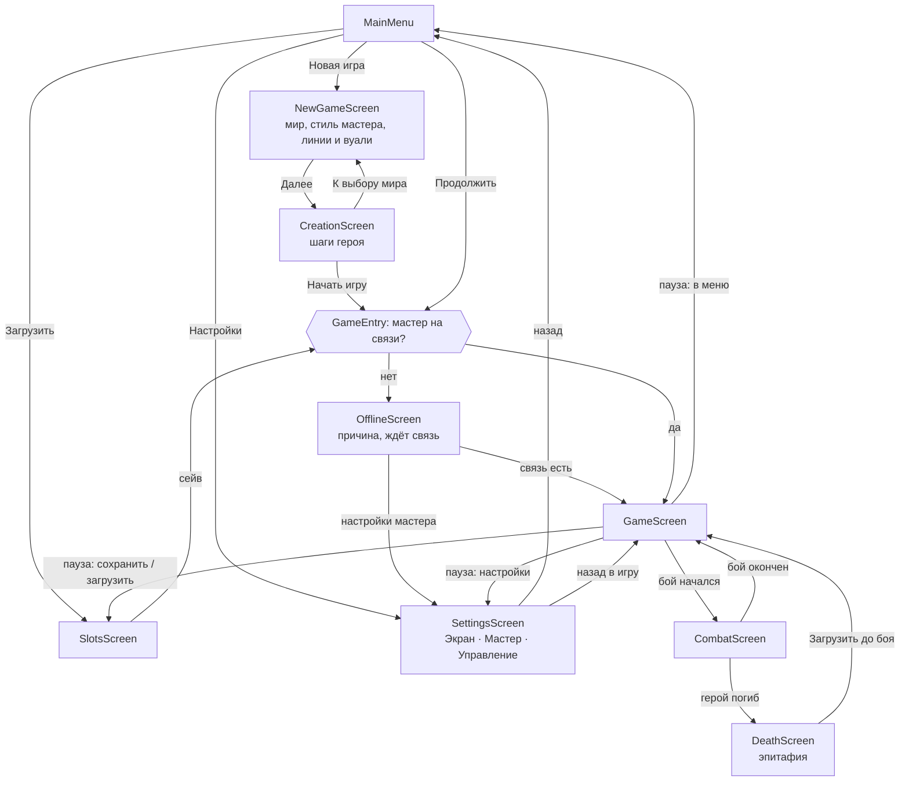

# Поток экранов

Какие экраны есть у Godot-клиента, как между ними переходят и какие окна открываются поверх игры. Правила окон, панели описания и клавиш — в [navigation.md](navigation.md); код — в [godot-client.md → «Поток экранов»](../../tech/godot-client.md#поток-экранов).

## Граф экранов

- Переход — `EventBus.navigate.emit(имя, параметры)`; список имён — в `main.gd` (`menu`, `new_game`, `creation`, `game`, `combat`, `death`, `slots`, `settings`, `offline`). Экран, открытый из игры, получает `back: "game"` и возвращается в неё.
- `session_started` всегда ведёт в игру, `session_closed` — в меню. Сейв, загруженный посреди боя, открывает сразу бой.
- Меню, настройки и сохранения работают без мастера; всё, что начинает или продолжает игру, идёт через `GameEntry` и при отсутствии связи — через «Мастер не на связи».

## Окна поверх игры

| Окно | Открывается | Что в нём |
|---|---|---|
| Лист персонажа | `C` / `K` / `I`, кнопка на панели | характеристики и навыки, умения и заклинания, снаряжение с куклой, развитие и цель жизни |
| Карта | `M`, строка задания над чатом | схема известных мест, быстрый переход |
| Журнал | `J` | задания с «Следить», люди, хроника, записи |
| Торговля | «Торговать» у торговца | свой экран поверх всего (v0.7.22.10): товары, корзина, торг |
| Карманы | «▾» у человека → карманы | что можно стащить, проверка |
| Контейнер | сундук, мешок, тело | взять и положить, замок |
| Место / доска | строка места, доска объявлений | что за место; заказы доски |
| Повышение уровня | кнопка при достатке опыта | выборы уровня, заклинания по кругам |
| Отдых, подготовка | кнопки отдыха | короткий отдых «−/+» костей, долгий, «Выбрано X из N» |
| Пауза | `Esc` | продолжить, сохранить, загрузить, настройки, в меню |

В бою свои окна поверх экрана боя: итоги боя (добыча по весу, «Взять всё, что унесу») и вопрос о реакции.

## Режимы экрана игры

Разговор и торговля — не отдельные экраны, а режимы игры (`session.mode`): в разговоре над чатом полоса «Разговор: имя» с «Закончить разговор», на панели — задания и передачи собеседника; торговля открывает своё окно. Режим включает мастер (`next_mode`) только в ответ на слова игрока или кнопка игрока; конец разговора — сводка для мастера (`summary.request`).

## Жизнь экранов

- Экран создаётся при переходе и уничтожается при уходе с него; состояние живёт не в экранах, а в `GameState.session` и сохраняется в сейв.
- Окна экрана игры создаются вместе с ним и прячутся, а не уничтожаются; при открытии и на каждое `EventBus.state_changed` они перестраивают содержимое из сессии.
- Смена масштаба интерфейса применяется сразу ко всему окну игры; смена клавиш — сразу, без перезапуска.
